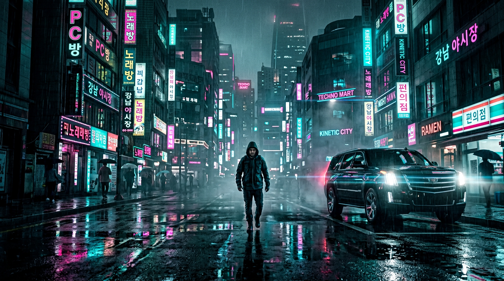

# NEON DISTRICT

Открытый город в духе классических городских боевиков — **Unity 6.3 LTS**, десктоп (Windows x64), URP.
Город — реальная детальная модель Манхэттена (260 000 полигонов, 8 × 8 км), плюс Renderpeople-персонажи,
три машины (Mercedes GLS 580, Polestar 4 с анимацией дверей, Corvette Stingray) и 40 городских ассетов Seoul City Builder Kit.



## Что уже есть (v0.1, вертикальный срез)

| Система | Состояние |
|---|---|
| Город Манхэттен: геометрия, 106 текстур, материалы | ✅ импортируется автоматически |
| Сетка улиц (анализ модели → JSON) для трафика и пешеходов | ✅ |
| Игрок: CharacterController, бег/прыжок/присед, Humanoid-анимация | ✅ |
| Процедурный «умный» анимационный слой: наклон корпуса, отдача, приземление | ✅ |
| Камера от третьего лица с коллизией и режимом машины | ✅ |
| Машины: физика, крен/клевок, фары, стопы, ручник, звук-RPM хук | ✅ |
| Трафик: 16 машин, повороты на перекрёстках, дистанция, торможение перед игроком | ✅ |
| Пешеходы: NavMesh, блуждание, испуг от выстрела, падение | ✅ |
| Цикл суток URP: солнце/луна, туман, неон, bloom/vignette, экспозиция | ✅ |
| HUD: часы, район, деньги, розыск, здоровье/броня, спидометр, патроны | ✅ |
| Меню, пауза, сохранение/загрузка (JSON) | ✅ |
| Стрельба: raycast, урон, гильзы/вспышка (заготовка) | ✅ |
| Пост-обработка: ACES, bloom, виньетка, цветокоррекция, SSAO | ✅ |
| **Полиция**: 3 патруля (GLS / AMG / Polestar) с ливреей, мигалками, синтезированной сиреной и ИИ погони | ✅ |
| **GitHub Actions**: автосборка Windows + Linux, артефакты и релизы по тегу | ✅ |

Дальше по плану: миссии и диалоги, угон/полиция с погоней, экономика и магазины, радио и лицензионный саундтрек, Motion Matching для персонажа, погодные пресеты.

## Требования
- **Unity 6.3 LTS** (6000.3.x) — ставится через Unity Hub;
- Windows 10/11 x64 (проект собирается и под Linux/macOS);
- 16 ГБ RAM, GPU 6+ ГБ VRAM (для 1080p high).

## Быстрый старт (5 минут)
1. Unity Hub → **Add project from disk** → папка `NeonDistrict`.
2. Открыть проект. Первый импорт — 3–10 минут (город + текстуры).
3. Меню **Neon District → 1) Setup Project** — URP, тени, материалы Манхэттена, Player Settings.
4. Меню **Neon District → 2) Build Prefabs** — игрок, прохожий, три машины, аниматоры.
5. Меню **Neon District → 4) Bake NavMesh** — один раз (1–3 минуты).
6. Меню **Neon District → 3) Build Playground Scene** → **Play**.

Если сцена не собралась — откройте `Assets/Scenes/Playground.unity` вручную, она создаётся генератором.

## Полиция и розыск
Всё в `Assets/Scripts/Police`:

| Файл | Что делает |
|---|---|
| `PoliceLivery.cs` | превращает любую машину в патруль: белый кузов, ливрея на бортах (декали), LED-балка, отбойник, антенна. Мигалки — красно/синяя последовательность как у настоящей полиции |
| `PoliceAI.cs` | догоняет игрока «наперерез», таранит, прижимает; при остановке рядом — задержание со штрафом `$250 × уровень` |
| `PoliceSpawner.cs` | уровень розыска 1 → 1 патруль, 3 → 2, 5 → 3; спавн за спиной, чтобы не появлялись в кадре |
| `PoliceSiren.cs` | двухтональная сирена, **синтезируется в рантайме** (не нужны аудиофайлы) |

Патрули собираются из уже имеющихся машин: `PoliceCar` (Mercedes GLS), `Police_AMG` (C63), `Police_Polestar`.
Ливрея и эмиссия мигалок генерируются скриптом `Assets/Art/Vehicles/Textures/make_police_textures.py`.

## CI/CD (GitHub Actions)
| Workflow | Что делает |
|---|---|
| `.github/workflows/verify.yml` | 1–2 мин: проверка структуры, JSON/`.inputactions`, санитайзинг C# (`tools/check_csharp.py`) |
| `.github/workflows/build.yml` | сборка **Windows x64** и **Linux x64** через `game-ci/unity-builder`, артефакты 30 дней, релиз при пуше тега `v*` |

Сборка вызывает `NeonDistrict.EditorTools.CIBuild.BuildWindows` — метод сам готовит проект (URP, префабы, сцена) и собирает билд.

### Что нужно один раз настроить
1. **Secrets** в GitHub → Settings → Secrets and variables → Actions:
   - `UNITY_LICENSE` — содержимое файла лицензии `.ulf` (Personal: получите через `game-ci/unity-request-activation-file` + активация на license.unity3d.com);
   - либо `UNITY_EMAIL` + `UNITY_PASSWORD` (+ `UNITY_SERIAL` для Pro).
2. Проверить версию: `UNITY_VERSION` берётся из `ProjectVersion.txt` и по умолчанию `6000.3.29f1` (вход workflow_dispatch позволяет переопределить).
3. Запустить: **Actions → Build → Run workflow**, либо пуш в `master`, либо тег:
   ```
   git tag v0.1.0 && git push origin v0.1.0
   ```
   → появится GitHub Release с `NeonDistrict-Windows.zip`.

## Управление
| Действие | Клавиша |
|---|---|
| Движение | W A S D |
| Бег | Shift |
| Прыжок / ручник | Space |
| Сесть / выйти из машины | E или F |
| Огонь | ЛКМ |
| Перезарядка | R |
| Присед | C |
| Пауза | Esc |

## Структура проекта
```
Assets/
  Art/
    Manhattan/        город: Manhattan.fbx + Textures/ (106) + manhattan_layout.json + manhattan_info.json
    Characters/       Player_Male.fbx (walk), NPC_Female.fbx (idle) + текстуры
    Vehicles/         Mercedes_GLS.fbx, Polestar_4.fbx (двери, анимации), Corvette_Stingray.fbx
    City/             Seoul City Builder Kit (free sample): здания, деревья, реквизит, знаки, седаны
    Animation/        сгенерированные Animator Controller'ы
    Materials/        URP-материалы персонажей и машин
  Scripts/
    Core/             GameManager, SaveSystem, ввод
    World/            CityController, CityLayout, TrafficSystem, PedestrianSpawner, DayNightCycle
    Player/           PlayerController, LocomotionAnimator, Pedestrian, CharacterNormalizer
    Vehicles/         VehicleController (аркадная физика + свет + звук-RPM)
    Camera/           ThirdPersonOrbit
    UI/               HUDController, MainMenuUI, RuntimeUI (HUD собирается кодом)
    Editor/           ProjectSetup, AssetPipeline, SceneSetup (меню Neon District)
  Scenes/             Playground.unity (генерируется)
docs/                 key art + Blender-превью ассетов
tools/                Blender-пайплайн конвертации (см. ниже)
```

## Инструменты ассетов (Blender, вне Unity)
Всё, что нужно для повторной подготовки моделей, лежит в `tools/`:
- `export_unity_fbx.py` — FBX/GLB → Unity-FBX: метры, Y-up, −Z вперёд, пивот в центре днища, выравнивание длинной оси по X.
- `analyze_city.py` — анализ городской модели: угол сетки, границы, карта занятости, линии улиц → JSON.
- `export_manhattan.py` — разворот города под «ровную» сетку и экспорт.
- `export_asset.py` — GLB-пайплайн (текстуры, LOD, анимации) для веб-прототипов.

Запуск: `blender -b --factory-startup --python tools/export_unity_fbx.py -- <src> <dst> car 5.2`

## Лицензии и происхождение ассетов
- **Manhattan** — Sketchfab-модель (демо/учебный проект). **Mercedes GLS 580 / AMG C63**, **Corvette Stingray (NFS Unbound)**, **Polestar 4** — пользовательские наборы.
- **Renderpeople** — Nathan (walk), Sophia (idle).
- **Seoul City Builder Kit (free sample)** — royalty-free, текст: `Assets/Art/City/SEOUL_KIT_LICENSE.txt`.

> ⚠️ Для публичного релиза нужно подтвердить права на город и машины либо заменить их. Код игры — ваш.

## Производительность
- Город статичен → static batching, тени 4096, 4 каскада.
- Модели машин: Polestar 616k трис — для трафика используйте LOD (генератор `NeonDistrict → 2)`) или замените трафик на `Assets/Art/City/vehicles/vehicle_sedan` (4.3k трис).
- Пешеходы — до 26 одновременно, спавн/деспавн по радиусу.
